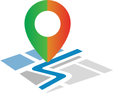

# AQIPath

<p align="center">
  
</p>

**Navigate by the air you breathe.** AQIPath is an Android and iOS app that finds the route with the cleanest air, using real-time Air Quality Index (AQI) data together with live traffic and travel times. Runners and cyclists can also generate loop routes of a chosen distance that start and end at home.

[](https://play.google.com/store/apps/details?id=com.tekzee.aqiapp)
[](https://apps.apple.com/app/id6754751849)


> Android package ID: `com.tekzee.aqiapp` · Category: Weather · Content rating: Everyone

---

## Why AQIPath?

The fastest route is often the most polluted one: busy arterial roads, junctions and industrial belts. Standard navigation apps optimise only for time. AQIPath adds air quality to the equation so you can choose how much extra time you are willing to trade for cleaner air, whether you are commuting, doing the school run, or going for a run.

## Features

- **Cleanest-route navigation.** Compares route options using real-time AQI along the path, live traffic and estimated travel time, then recommends the one with the lowest pollution exposure.
- **Fitness loop routes.** Pick a distance and get a walking or cycling loop around your location that starts and ends at the same point, biased toward low-AQI streets.
- **Live colour-coded AQI map.** Current AQI, pollutant breakdown (PM2.5, PM10, CO, NO₂, O₃ and more) and a heatmap of the area around you.
- **Live navigation with AQI updates.** Background location tracking keeps a notification updated with the AQI where you are and your next turn, and flags when you leave the route.
- **Health tips.** Recommendations matched to the current AQI band.
- **History.** Saved AQI readings and past trips, with a profile chart of your exposure.
- **Accounts.** Sign in with Google, Apple or email (Firebase Authentication).

### Who is it for?

Daily commuters, runners and cyclists, parents on school runs, travellers in unfamiliar cities, and anyone with asthma or other respiratory sensitivities.

## Download

- **Android** — [Google Play](https://play.google.com/store/apps/details?id=com.tekzee.aqiapp)
- **iOS** — [App Store](https://apps.apple.com/app/id6754751849)

## How it works

1. **Locate.** The app reads your location (with your permission) and your chosen destination or loop distance.
2. **Sample the air.** AQI is fetched for a grid of anchor points around you (Google Air Quality API first, WAQI as a fallback), and values in between are interpolated by inverse-distance weighting.
3. **Generate candidates.** Candidate paths and loops are built through low-AQI points and pruned with a beam search.
4. **Score and rank.** Each candidate gets an average-AQI exposure score; the best few are sent to the Google Directions API for real polylines, distance, duration and traffic.
5. **Keep watching.** During a trip, a background location service snaps you to the route, looks up the nearest AQI reading and updates the notification.

## AQI reference

| AQI | Category | Meaning |
|-----|----------|---------|
| 0–50 | Good | Air quality is satisfactory |
| 51–100 | Moderate | Acceptable; sensitive people may be affected |
| 101–150 | Unhealthy for sensitive groups | Sensitive groups may experience effects |
| 151–200 | Unhealthy | Everyone may begin to experience effects |
| 201–300 | Very unhealthy | Health alert for everyone |
| 301+ | Hazardous | Emergency conditions |

Bands follow the US EPA scale. The app can also compute India's CPCB index (see `lib/utils/Aqi_calculator.dart`), which uses different breakpoints.

---

## Tech stack

| Area | Libraries / services |
|------|----------------------|
| Framework | Flutter (Dart SDK ^3.7.2), Android + iOS |
| State management | `flutter_bloc`, `provider`, `bloc_concurrency` |
| Maps & location | `google_maps_flutter`, `geolocator`, `location`, `geocoding`, `flutter_polyline_points`, `google_places_flutter` |
| Background tracking | `background_locator_2` (vendored in `plugins/`), `flutter_local_notifications` |
| Backend | Firebase Auth, Cloud Firestore, Firebase Storage, Firebase Cloud Messaging |
| Networking | `dio`, `http`, `connectivity_plus` |
| Local storage | `hive` / `hive_flutter` (AQI cache, history), `shared_preferences` |
| Air-quality data | Google Air Quality API, WAQI (World Air Quality Index), API Ninjas |
| Routing | Google Directions API, Google Places Autocomplete |

## Project structure

```
.
├── android/                     # Android host app (Kotlin, Gradle KTS)
├── ios/                         # iOS host app (Swift, CocoaPods)
├── assets/
│   ├── fonts/                   # Inter, Open Sans, Poppins, Roboto
│   ├── icons/  images/          # SVG icons, PNG/GIF images
│   └── locale/                  # en.json, vi.json, health_recommandation_tips.json
├── lib/
│   ├── main.dart                # Entry point: Firebase, Hive, notifications
│   ├── app_view.dart            # Root widget, routing, theme
│   ├── configs/                 # Router, theme, network, permissions, notifications
│   ├── constants/               # Colours, fonts, images, API keys (from --dart-define)
│   ├── data/
│   │   ├── local/               # Hive models + SharedPreferences
│   │   ├── models/              # AQI responses, routes, user, config
│   │   ├── repository/          # AQI route, map screen, home, auth, user, storage
│   │   └── request/             # API calls (allAPIs.dart) and base URLs
│   ├── presentation/
│   │   ├── common_blocs/        # App, auth, language, profile blocs
│   │   ├── screens/             # splash, login, register, home, check AQI,
│   │   │                        # location/navigation, auto AQI route, profile, settings
│   │   └── widgets/             # Shared buttons and UI components
│   └── utils/                   # AQI calculator, geo utils, background services, dialogs
├── plugins/background_locator_2/  # Local copy of the background location plugin
├── test/
├── web/
└── pubspec.yaml
```

## Getting started (development)

### Prerequisites

- Flutter SDK with Dart 3.7.2 or newer (`flutter doctor` should be clean)
- Android Studio (Android SDK, JDK 17) and/or Xcode with CocoaPods for iOS
- A Firebase project
- A Google Cloud project with **Maps SDK for Android**, **Maps SDK for iOS**, **Directions API**, **Places API**, **Geocoding API** and **Air Quality API** enabled
- A [WAQI token](https://aqicn.org/data-platform/token/) and an [API Ninjas key](https://api-ninjas.com/)

### 1. Clone and install packages

```bash
git clone https://github.com/AnayMehta976/AQIPath.git
cd AQIPath
flutter pub get
```

### 2. Add your API keys

No keys are committed to this repository. Each platform reads them from a git-ignored file:

| What | File to create | Template |
|------|----------------|----------|
| Dart-side keys (Maps/Places/Directions/Air Quality, WAQI, API Ninjas) | `dart_defines.json` | `dart_defines.example.json` |
| Android Maps SDK key | add `MAPS_API_KEY=...` to `android/local.properties` | — |
| iOS Maps SDK key | `ios/Flutter/Secrets.xcconfig` | `ios/Flutter/Secrets.xcconfig.example` |

```bash
cp dart_defines.example.json dart_defines.json
cp ios/Flutter/Secrets.xcconfig.example ios/Flutter/Secrets.xcconfig
echo "MAPS_API_KEY=your_android_maps_key" >> android/local.properties
```

Restrict each Google key in Cloud Console (Android package + SHA-1, iOS bundle ID, and the specific APIs above).

### 3. Connect Firebase

Download your Firebase config files and place them here (both are git-ignored):

- `android/app/google-services.json`
- `ios/Runner/GoogleService-Info.plist`

Enable Authentication (Google, Apple, Email/Password), Cloud Firestore, Storage and Cloud Messaging in the Firebase console.

### 4. Run

```bash
flutter run --dart-define-from-file=dart_defines.json
```

If you change a Hive model, regenerate the adapters:

```bash
dart run build_runner build --delete-conflicting-outputs
```

### Release builds

Android release signing reads `android/key.properties` (template: `android/key.properties.example`). Without it, release builds fall back to the debug key.

```bash
flutter build appbundle --release --dart-define-from-file=dart_defines.json
flutter build ipa --release --dart-define-from-file=dart_defines.json
```

## Key APIs used

| API | Used for | Where |
|-----|----------|-------|
| Google Air Quality `currentConditions:lookup` | Primary AQI, pollutants, health recommendations | `lib/data/request/allAPIs.dart` |
| WAQI `feed/geo:{lat};{lng}` | Fallback AQI | `allAPIs.dart`, `Home_repository.dart`, `aqi_channel.dart` |
| Google Directions | Route polylines, distance, duration, traffic | `allAPIs.dart`, `aqi_route_repo.dart` |
| Google Places Autocomplete | Destination search | `Custom_Place_search.dart` |

## Roadmap

- [ ] Offline caching of recent AQI readings
- [ ] Personal exposure history and weekly summary
- [ ] Health profiles (asthma and other sensitivities) with tailored thresholds
- [ ] Wear OS companion for run tracking
- [ ] Hindi and other regional languages

## Contributing

See [CONTRIBUTING.md](CONTRIBUTING.md). Never commit API keys, keystores, Firebase config files or `local.properties`. The `.gitignore` already covers them.

## Privacy

See [PRIVACY.md](PRIVACY.md).

## Support

- Bug reports and feature requests: [GitHub Issues](https://github.com/AnayMehta976/AQIPath/issues)
- Email: anaymht12@gmail.com

## Acknowledgements

Air quality data comes from Google, the World Air Quality Index project and API Ninjas; routing from Google Maps Platform. Background tracking uses a vendored copy of [`background_locator_2`](https://pub.dev/packages/background_locator_2) (MIT). App development by Tekzee Technologies.
